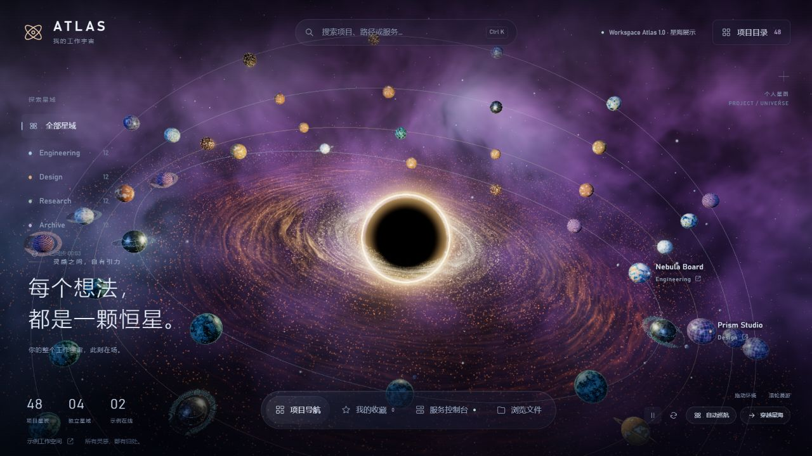
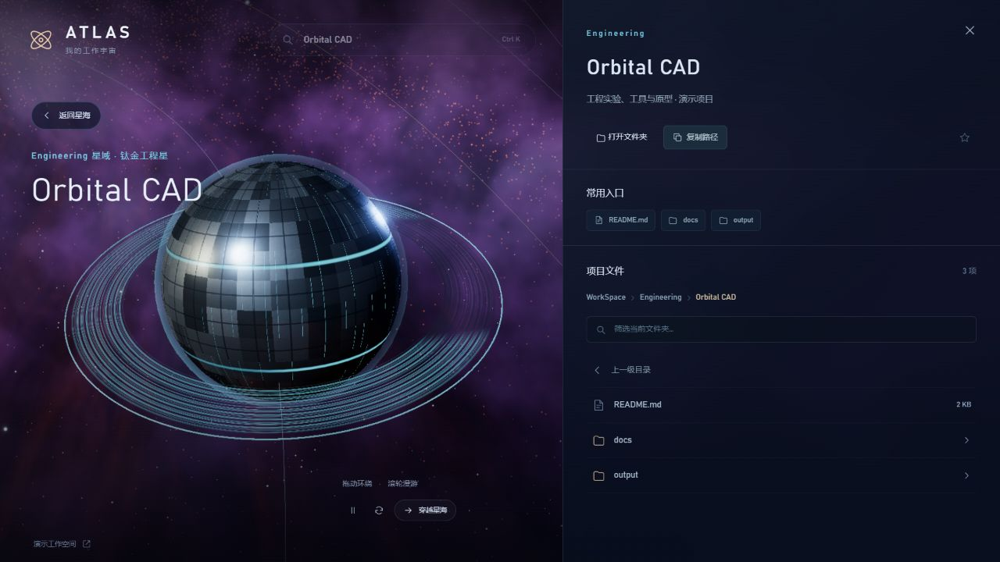

# Workspace Atlas

**A small universe for your projects.**

A Three.js workspace navigator with procedural planets, nebulae, rings and moons. Select a planet to fly toward its project, or start an automatic cruise through your current selection.

[Live demo](https://cgbpnw5bw4-create.github.io/workspace-atlas/) · [中文说明](README.md) · [MIT License](LICENSE)



## Run the demo

Requires **Node.js 24** and a modern browser with **WebGL 2**.

```sh
npm ci
npm run dev
```

Open the local URL printed by Vite. The default demo includes **48 fictional projects** across Engineering, Design, Research and Archive. Files and service states are simulated. No account, API key, local filesystem scan or business backend is required.

```sh
npm run build
npm run preview
```

The generated `dist/` folder is a static site suitable for GitHub Pages.

## Explore

- Drag to orbit; scroll to zoom. Both take over an active cruise.
- Select a planet, label or project card to fly closer and open its panel.
- Use `Ctrl+K` / `⌘K` to search, and `Esc` to stop a cruise, cancel a flight or close a panel.
- Filter by group, switch between grid and list, and save favorites in your browser.
- Automatic cruise follows the current project selection. Pause controls ambient animation.



## Optional local workspace

Organize folders as `workspace/group/project`. Explicitly set your own root to enable local browsing:

```powershell
npm run build
$env:ATLAS_ROOT = 'D:\YourWorkspace'
npm start
```

Open `http://127.0.0.1:4317`; the server redirects to local mode. Set `ATLAS_PORT` to change the port. On Linux/macOS, use `ATLAS_ROOT=/path/to/workspace npm start`.

Directory browsing is cross-platform. Opening files with their default application and revealing files in Explorer require Windows; other platforms return an unsupported-operation response. The generic local mode does not include business service launch commands and returns an empty service list. Without `ATLAS_ROOT`, `npm start` serves the demo.

**Keep the local API on loopback. Do not expose it through a public tunnel or reverse proxy.** Publish only the static demo to GitHub Pages.

## Implementation and limits

`src/main.js` handles navigation, `src/scene.js` owns the scene and camera, `src/planets.js` generates planets, and `src/nebula.js` renders the background. `server.mjs` provides the optional local API. Boundary tests live in `tests/`.

This is an artistic visualization, not an astronomical simulation. Performance depends on your GPU; the project directory remains available when 3D acceleration cannot start. The build may report a scene chunk larger than 500 kB.

Released under the [MIT License](LICENSE). See [third-party notices](THIRD_PARTY_NOTICES.md) for dependency attribution.
