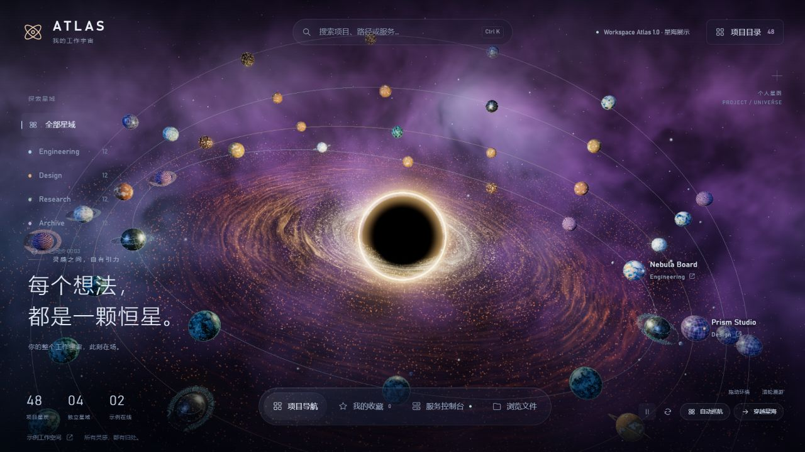
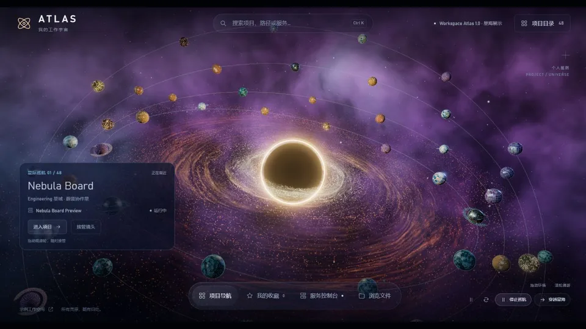
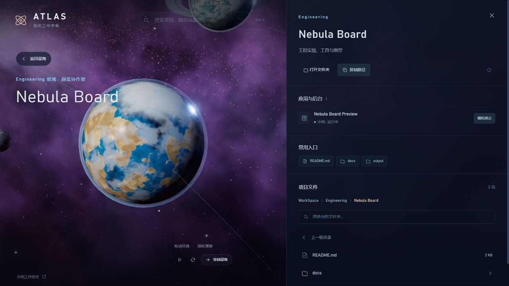

<p align="center">
  
</p>

<h1 align="center">Workspace Atlas</h1>

<p align="center"><strong>项目与灵感的三维工作空间</strong></p>
<p align="center">将项目映射为独立星球，以平滑飞行和自动巡航探索你的工作宇宙。</p>

<p align="center">
  <a href="https://github.com/cgbpnw5bw4-create/workspace-atlas/releases/tag/v1.0.0"></a>
  <a href="https://github.com/cgbpnw5bw4-create/workspace-atlas/actions/workflows/ci.yml"></a>
  <a href="https://cgbpnw5bw4-create.github.io/workspace-atlas/"></a>
  <a href="LICENSE"></a>
  <a href="package.json"></a>
  
</p>

<p align="center">
  <a href="https://cgbpnw5bw4-create.github.io/workspace-atlas/"><strong>在线体验</strong></a> ·
  <a href="https://github.com/cgbpnw5bw4-create/workspace-atlas/releases/tag/v1.0.0">1.0 发行说明</a> ·
  <a href="#快速开始">快速开始</a> ·
  <a href="#功能特性">功能特性</a> ·
  <a href="README.en.md">English</a>
</p>

---

Workspace Atlas 是一个基于 **Three.js + Vite** 的三维项目导航工具。程序生成的星云、吸积盘、行星与轨道构成项目星图；点击星球即可飞近项目，查看目录和文件入口。

<p align="center">
  <a href="https://cgbpnw5bw4-create.github.io/workspace-atlas/"></a>
  <br />
  <sub>48 个示例项目 · 4 个星域 · 打开浏览器即可体验</sub>
</p>

## 交互预览

<p align="center">
  
  <br />
  <sub>实际录制：自动巡航 → 返回星海 → 点击星球 → 平滑进入项目</sub>
</p>

## 功能特性

| 功能 | 说明 |
| --- | --- |
| **程序化星球** | 每个项目拥有由稳定种子生成的地貌、配色、大气、星环与卫星组合。 |
| **平滑镜头飞行** | 点击星球、浮动标签或目录卡片，抵达后展开项目面板。 |
| **自动巡航** | 按当前筛选依次掠过项目，拖动、滚轮或按钮可随时接管。 |
| **项目目录** | 搜索、分组、排序与网格 / 列表视图，收藏保存在当前浏览器。 |
| **文件导航** | 浏览示例目录；连接本地目录后，可在 Windows 中打开或定位文件。 |
| **两种使用模式** | 星海展示可直接在线体验；本地模式用于导航自己的工作目录。 |

<p align="center">
  
  <br />
  <sub>从星海总览，抵达具体项目</sub>
</p>

## 快速开始

**环境要求：** Node.js **24 或更高版本**，以及支持 **WebGL 2** 的现代浏览器。

```sh
git clone https://github.com/cgbpnw5bw4-create/workspace-atlas.git
cd workspace-atlas
npm ci
npm run dev
```

打开终端显示的本地地址。默认运行星海展示，内置 48 个示例项目，不扫描电脑，也不需要账号、API Key 或业务后台。

构建并预览：

```sh
npm run build
npm run preview
```

`dist/` 可以部署为静态网站，包括 GitHub Pages。

## 交互操作

| 操作 | 效果 |
| --- | --- |
| 拖动 / 滚轮 | 环绕 / 缩放，巡航时立即接管 |
| 点击星球、标签或目录项目 | 飞近并打开项目 |
| `Ctrl+K` / `⌘K` | 聚焦项目搜索；文件面板打开时聚焦文件筛选 |
| `Esc` | 停止巡航、取消飞行，或关闭当前面板 |
| 自动巡航 | 依次参观当前筛选下的项目 |
| 暂停 / 返回总览 | 控制环境动画 / 返回星海 |

## 使用模式

| | 星海展示 | 本地工作空间 |
| --- | --- | --- |
| 项目来源 | 48 个示例项目，分布于 4 个星域 | 显式指定的本地根目录 |
| 文件导航 | 浏览器内示例目录 | 真实目录与文件入口 |
| 服务面板 | 模拟状态与启停，不执行系统命令 | 通用版本不接入业务后台 |
| 启用方式 | 在线体验或 `npm run dev` | 设置 `ATLAS_ROOT` 后运行 `npm start` |

### 连接本地目录

此功能按 `工作目录 / 分组 / 项目` 两级目录组织项目，例如：

```text
YourWorkspace/
├── Engineering/
│   ├── Orbital CAD/
│   └── Plasma Lab/
└── Design/
    └── Prism Studio/
```

在 PowerShell 中显式指定自己的根目录，再启动：

```powershell
npm run build
$env:ATLAS_ROOT = 'D:\YourWorkspace'
npm start
```

访问 `http://127.0.0.1:4317`，服务会进入本地模式。端口冲突时可先设置 `$env:ATLAS_PORT = '4318'`。Linux/macOS 可用 `ATLAS_ROOT=/path/to/YourWorkspace npm start`；目录浏览可跨平台使用，默认程序打开和资源管理器定位需要 Windows，其他平台会返回不支持的说明。

本地模式扫描项目目录、浏览文件，并在 Windows 中打开文件或定位目录。通用开源版未接入业务后台启动命令，本地服务列表为空。只有显式配置 `ATLAS_ROOT` 才会扫描本地目录；未设置时 `npm start` 提供星海展示。恢复星海展示可清除环境变量：`Remove-Item Env:ATLAS_ROOT`。

**本地 API 仅监听 `127.0.0.1`，请勿转发到公网。** GitHub Pages 提供静态星海展示，不部署本地 API，也不包含你的文件。

## 项目结构

| 文件 | 职责 |
| --- | --- |
| `src/main.js` | 目录、搜索、收藏、文件面板与场景交互 |
| `src/scene.js` | 星海、镜头飞行、巡航与项目选择 |
| `src/planets.js` | 可复现的程序化星球、星环与卫星 |
| `src/nebula.js` | 程序化星云背景 |
| `src/sample.js` | 示例项目、目录与服务状态 |
| `server.mjs` | 可选的本地目录 API 与静态文件服务 |
| `tests/` | 本地 API 信任边界测试 |
| `.github/workflows/` | 构建检查与手动 Pages 发布 |

运行检查：`npm test` · `npm run build`

## 已知限制

- 星海为艺术化导航场景，不是天文或物理模拟。
- 三维渲染性能取决于设备与 GPU；WebGL 初始化失败时会展示项目目录，自动巡航不可用。
- 示例项目与文件用于星海展示；服务状态与启停为模拟，不连接真实业务服务，也不执行系统命令。
- 当前场景构建分块超过 500 kB，会产生体积提示，构建仍可完成。

## 参与贡献

欢迎大家提供好的创意效果：星球地貌、星云配色、镜头运动、交互玩法，都可以通过 [Issues](https://github.com/cgbpnw5bw4-create/workspace-atlas/issues) 或 Pull Request 分享创意、参考图与实现，一起丰富这片星海。

也欢迎反馈问题或提出功能建议。报告问题时，请附上浏览器版本、操作系统与复现步骤。

## 许可证

项目使用 [MIT License](LICENSE)。Three.js 等依赖的归属和许可证见 [THIRD_PARTY_NOTICES.md](THIRD_PARTY_NOTICES.md)。
